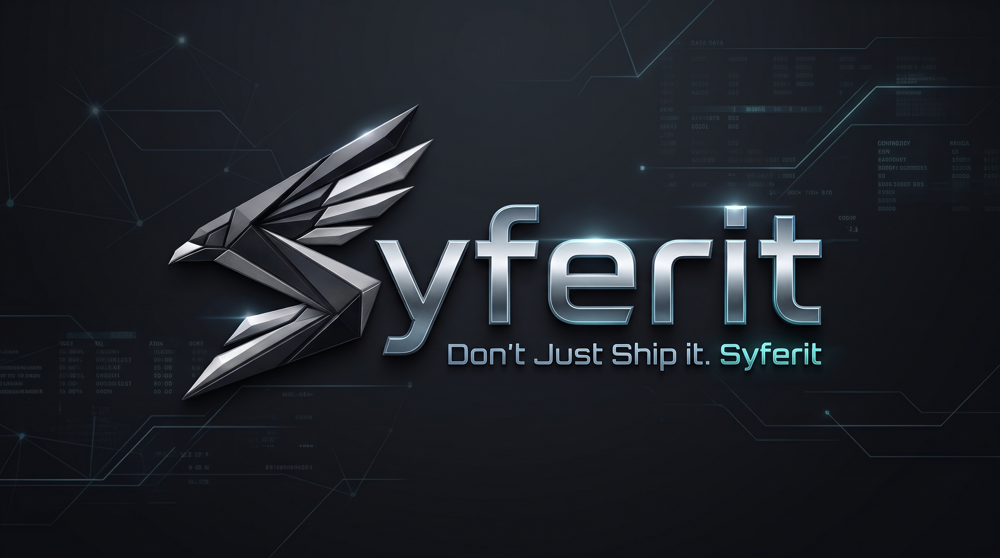

<p align="center">
  <a href="https://syferit.soltrixstudios.com">
    
  </a>
</p>

<h1 align="center">SYFERIT</h1>

<p align="center">
  <strong>Symbolic Feistel &amp; Residue Integrity Transformer</strong><br>
  <em>&ldquo;Don&apos;t Just Ship it. Syferit.&rdquo;</em><br><br>
  <strong>The open-core build-time code defense engine.</strong><br>
  Neutralizing autonomous AI reverse-engineering agents (REA), decompilation extractors, and clean-room source synthesis.
</p>

<p align="center">
  <a href="https://syferit.soltrixstudios.com"></a>
  <a href="https://www.npmjs.com/package/@syferit/core"></a>
  <a href="https://www.npmjs.com/package/@syferit/cli"></a>
  <a href="https://github.com/marketplace/actions/syferit-code-defense"></a>
  <a href="https://github.com/soltrix-studios/syferit/actions"></a>
  <a href="./showcase-audit/MASTER_BATTLE_TEST_LEDGER.md"></a>
  <a href="./LICENSE"></a>
  <a href="https://syferit.soltrixstudios.com/docs"></a>
</p>

<p align="center">
  
</p>

---

## What is Syferit?

The software industry has entered the **Autonomous AI Reverse-Engineering Era**. Frontier coding assistants (like Claude Code and Cursor), autonomous reverse-engineering agents (REA), and decompilation bridges have collapsed the barrier to inspecting and recreating compiled software. Automated tooling can now execute rapid **Decompile -> Understand -> Recreate** cycles against client-side bundles, desktop binaries, and backend applications in minutes.

Traditional minifiers and obfuscators were designed over a decade ago to defeat human eyes by renaming variables. They fail against modern AI because language models do not depend on variable names; they extract proprietary business logic directly from structural data flow, call hierarchies, and execution boundaries.

**Syferit** shifts the paradigm from simple variable obfuscation to **proactive build-time code defense engineered specifically for the AI era**:

* **Autonomous AI Agent Neutralization:** Directly blocks REA, autonomous reverse-engineering agents, and decompiler pipelines from analyzing and synthesizing proprietary business logic.
* **Trade Secret & IP Preservation:** Keeps proprietary algorithms, billing logic, licensing validation, and commercial workflows unreadable and unreplicable.
* **Runtime Anti-Tampering:** Protects production builds against unauthorized runtime hooks, binary patches, scraping, and competitor clean-room cloning.
* **100% Functional Equivalence:** Guarantees strictly deterministic, identical application behavior for all legitimate users and external APIs.
* **Sub-Millisecond Execution:** Ultra-lean performance footprint (<1-2% CPU overhead on execution hot paths) with zero runtime dependencies.
* **SEO & Core Web Vitals Safe:** Operates exclusively at compile time without modifying HTML, DOM hydration, server-side rendering (SSR), or structured metadata.

---

## The Proof: What NSA Ghidra 12.1 Sees

During empirical adversarial battle-testing against the **NSA Ghidra 12.1 PUBLIC** decompiler, Syferit's textual LLVM IR pass collapsed proprietary business algorithms into un-reducible Euler quartic zero-invariants and polynomial Mixed Boolean-Arithmetic (MBA) ring identities:

### Original Source (C / LLVM)
```c
// Proprietary institutional fee calculation
int calculate_fee(int principal) {
    int scaled = (principal * 105) / 100;
    return scaled + 40014;
}
```

### Decompiled Output Recovered by Ghidra 12.1
```c
undefined4 calculate_fee(uint uParm1) {
    uint uVar1;

    uVar1 = (uParm1 * 0x69) / 100;

    // Euler quartic zero-invariant: (a^4 + b^4 + c^4 = d^4)
    // Decompiler cannot prove unreachable; runtime trap halts execution if altered
    if (((uVar1 ^ 0x5f) + 0x1a) == 0xdeadbeef) {
        __llvm_trap();
    }

    // Polynomial Mixed Boolean-Arithmetic ring identity:
    // x + y == (x ^ y) + 2 * (x & y)
    return (uVar1 ^ 0x9c4e) + (uVar1 & 0x9c4e) * 2;
}
```

---

## Syferit vs. Legacy Obfuscators

| Capability | Legacy Tools (Uglify / Terser / JS-Obfuscator) | Syferit Engine (v1.0.0) |
| :--- | :---: | :---: |
| **Resilience to AI Reverse-Engineering Agents** | :x: Fails (AI infers logic from dataflow) | :white_check_mark: **Immune** (Opaque dispatch & Feistel networks) |
| **Multi-Runtime Coverage** | JavaScript only | :white_check_mark: **JS, TS, WASM, LLVM IR, Python, Electron** |
| **Decompiler Resistance (Ghidra, WABT)** | :x: None | :white_check_mark: **Empirically Proven** (Euler & MBA invariants) |
| **Statutory Legal Notice Inoculation** | :x: Stripped or ignored | :white_check_mark: **Cryptographically Bound** (DMCA § 1201 CPU traps) |
| **Clean-Room Verification** | :x: Untested | :white_check_mark: **100% Bit-for-Bit Parity** (26 institutional vectors) |
| **Runtime Performance Impact** | :warning: Severe (up to 300%+ slowdown) | :white_check_mark: **Negligible** (<1-2% CPU on hot paths) |
| **CI/CD Integration** | :x: Manual scripts | :white_check_mark: **Official 1-Line GitHub Action** |

---

## Monorepo Packages

All 10 packages are live on npm with cryptographic provenance verified via GitHub Actions OIDC and Sigstore:

| Package | Version | npm Status | Description |
| :--- | :---: | :---: | :--- |
| [`@syferit/core`](./packages/core) | `v1.0.0` | [](https://www.npmjs.com/package/@syferit/core) | Core AST transformation engine & MBA obfuscation primitives. |
| [`@syferit/cli`](./packages/cli) | `v1.0.0` | [](https://www.npmjs.com/package/@syferit/cli) | Universal command-line tool for multi-target batch hardening. |
| [`@syferit/vite-plugin`](./packages/vite-plugin) | `v1.0.0` | [](https://www.npmjs.com/package/@syferit/vite-plugin) | Zero-config build plugin for Vite, Nuxt, SvelteKit, and Astro. |
| [`@syferit/next`](./packages/next) | `v1.0.0` | [](https://www.npmjs.com/package/@syferit/next) | Next.js adapter (`withSyferit`) protecting client bundles without affecting RSC/SSR. |
| [`@syferit/webpack-plugin`](./packages/webpack-plugin) | `v1.0.0` | [](https://www.npmjs.com/package/@syferit/webpack-plugin) | Webpack 5 asset optimization plugin for enterprise bundlers. |
| [`@syferit/electron`](./packages/electron) | `v1.0.0` | [](https://www.npmjs.com/package/@syferit/electron) | Electron ASAR hardening & active synthetic IPC honeypots. |
| [`@syferit/wasm`](./packages/wasm) | `v1.0.0` | [](https://www.npmjs.com/package/@syferit/wasm) | WebAssembly binary protection & control-flow flattening. |
| [`@syferit/llvm`](./packages/llvm) | `v1.0.0` | [](https://www.npmjs.com/package/@syferit/llvm) | Native C, C++, Rust, and LLVM IR protection engine. |
| [`@syferit/python`](./packages/python) | `v1.0.0` | [](https://www.npmjs.com/package/@syferit/python) | Python 3 source & runtime defense with dynamic S-Box keystreams. |
| [`@syferit/benchmarks`](./packages/benchmarks) | `v1.0.0` | [](https://www.npmjs.com/package/@syferit/benchmarks) | Token Burn Multiplier (TBM) evaluation & benchmark suite. |

---

## Quickstart

### 1. GitHub Actions CI/CD (Drop-in Protection)

Add this step to your GitHub Actions workflow after your build step:

```yaml
- name: 🛡️ Protect Release with Syferit
  uses: soltrix-studios/syferit-action@v1
  with:
    target: './dist'
    preset: 'hardened'
    domain: 'saas'
```

### 2. Vite & Modern Frontends (React, Vue, Svelte)

```bash
npm install -D @syferit/vite-plugin
```

Add to your `vite.config.ts`:

```ts
import { defineConfig } from 'vite';
import react from '@vitejs/plugin-react';
import { syferit } from '@syferit/vite-plugin';

export default defineConfig({
  plugins: [
    react(),
    syferit({
      mode: 'production', // Protects production builds automatically
      preset: 'hardened', // standard, hardened, or maximum
      seed: null // Auto-generates a fresh CSPRNG UUIDv4 per build
    })
  ]
});
```

### 3. Standalone CLI (Any Framework or CI/CD)

```bash
# Protect an entire build directory into a new protected folder
npx @syferit/cli protect ./dist --out ./dist-protected --preset hardened

# In-place protection
npx @syferit/cli protect ./dist --preset maximum

# Protect with a specific domain profile (saas, fintech, security, gaming)
npx @syferit/cli protect ./dist -d fintech --preset hardened
```

### 4. Enterprise Python 3

```bash
npx @syferit/cli protect ./pipeline.py --preset hardened
```

### 5. Native C/C++ via LLVM IR

```bash
clang -S -emit-llvm -O2 module.c -o module.ll
npx @syferit/cli protect module.ll --preset hardened --out module_hardened.ll
clang -O2 module_hardened.ll -o module.bin
```

---

## Interactive Clean-Room Verification (Google Colab)

Reproduce all 26 institutional financial test vectors and adversarial inspections in clean-room cloud runtimes at zero cost:

- **Verification Matrix:** 5 targets, 26 vectors, 100% mathematical parity.
- **Decompiler Tests:** NSA Ghidra 12.1 PUBLIC, WABT 1.0.42 (`wasm2wat`), Python AST/bytecode disassemblers, and `morluto/rea`.
- **Download Bundle:** [`syferit_battle_test_bundle.zip`](https://github.com/soltrix-studios/syferit/releases/tag/v1.0.0)

---

## Documentation

* [Documentation Hub](./docs/README.md)
* [Quickstart Guide](./docs/QUICKSTART.md)
* [Configuration Reference](./docs/CONFIGURATION.md)
* [Framework Integrations](./docs/FRAMEWORKS.md)
* [WebAssembly Protection Guide](./docs/WEBASSEMBLY.md)
* [Native C, C++, Rust & LLVM Guide](./docs/NATIVE_AND_LLVM.md)
* [Python 3 Protection Guide](./docs/PYTHON.md)
* [Security Policy](./SECURITY.md)
* [Contributing Guide](./CONTRIBUTING.md)
* [FAQ (SEO, Performance, & Security)](./docs/FAQ.md)

---

## License

Apache-2.0 (c) **Soltrix Studios**
