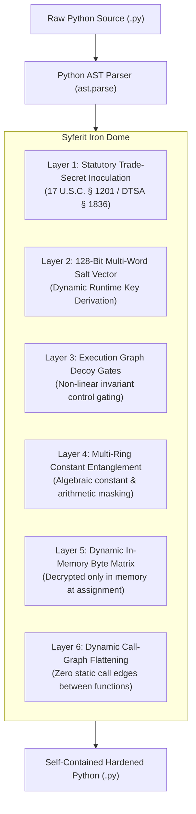

# Python Code Defense Guide (`@syferit/python` & Universal CLI)

Syferit provides comprehensive adversarial code protection for Python 3 (`.py`) source code, AI/ML inference pipelines, proprietary model loaders, quantitative trading algorithms, FastAPI/Django backends, and standalone desktop distributions (such as PyInstaller, cx_Freeze, and Nuitka).

It is distributed via the universal Syferit CLI (`@syferit/cli`) and the `@syferit/python` transformation engine, providing a self-contained, pre-compiled defense pass that requires zero PyPI source exposure.

---

## 🛡️ Why Python Applications Need AI-Era Defense

Python is the standard language of modern AI, data science, financial engineering, and backend automation. However, standard Python applications face severe security vulnerabilities:

1. **Zero-Friction Decompilation:** Distributed `.py` scripts and compiled `.pyc` bytecode (even when bundled inside PyInstaller executables or Docker containers) are trivially decompiled back into clean, readable Python source code within seconds using tools like `uncompyle6` or `decompyle++`.
2. **Autonomous AI Cloning:** AI reverse-engineering agents can ingest an entire Python codebase, trace sensitive pricing algorithms, proprietary weights-loading routines, or internal prompt templates, and reproduce a clean clone in minutes.
3. **Static Call-Graph Extraction:** Static analysis tools automatically extract the call graph of your application, isolating security functions and license checkers.

**Syferit transforms Python AST and source code into an entangled, mathematically irreducible representation while maintaining 100% standard Python 3 compatibility with zero runtime dependencies.**

---

## 🚀 Quickstart: Universal Syferit CLI

The fastest and most secure way to protect Python code is using the universal Syferit CLI:

```bash
# Zero-install execution via npx (protect a single Python module)
npx @syferit/cli protect app.py -o app_protected.py --preset hardened

# Protect an entire directory or package recursively
npx @syferit/cli protect ./src -o ./dist --preset maximum

# Global terminal installation
npm install -g @syferit/cli
syferit protect ./src -o ./dist --preset maximum
```

### CLI Command Reference

| Flag | Description | Default |
| :--- | :--- | :--- |
| `target` or `-t, --target` | Path to `.py` file or directory to protect | *(Required)* |
| `-o, --out, --output` | Destination output file or directory | *(In-place overwrite)* |
| `--preset` | Defense intensity: `standard`, `hardened`, or `maximum` | `'hardened'` |
| `-d, --domain, -p, --profile` | Anti-fingerprinting domain dictionary: `saas`, `fintech`, `security`, `gaming` | `'saas'` |
| `-s, --seed` | Deterministic seed integer or string (for reproducible builds) | *(Auto-generated UUIDv4)* |

---

## 🐍 Python Library API

For custom build scripts, wheel packaging, or CI/CD integration, use the `syferit` Python module directly:

```python
from syferit import protect_code, protect_file, PythonTransformer

# 1. Quick inline source string protection
raw_python = """
def authenticate_license(key):
    expected = 0x4B3A
    if key == expected:
        return "GRANTED"
    return "DENIED"
"""

protected_code = protect_code(raw_python, preset="hardened")
print(protected_code)

# 2. File-to-file transformation
protect_file("src/engine.py", "build/engine.py", preset="maximum")

# 3. Advanced pipeline configuration
transformer = PythonTransformer(
    preset="maximum",
    domain_profile="fintech",
    encrypt_strings=True,
    dynamic_dispatcher=True,
    strip_docstrings=True,
    seed=0x1337BEEF
)

result = transformer.transform(raw_python)
print(f"Transformed {result.transformed_count} functions. Derived key: {hex(result.state_key_derived)}")
```

---

## 🌐 Node.js / Monorepo Integration (`@syferit/python`)

If your build pipeline is orchestrated with Node.js, you can run Syferit via npm or npx:

```bash
# Using npx (zero install)
npx @syferit/cli protect ./src --out ./dist-protected

# Programmatic Node.js API
npm install -D @syferit/python
```

```typescript
import fs from 'node:fs';
import { PythonTransformer } from '@syferit/python';

const transformer = new PythonTransformer({
  preset: 'hardened',
  domainProfile: 'security'
});

const result = transformer.transform(fs.readFileSync('engine.py', 'utf-8'));
fs.writeFileSync('dist/engine.py', result.code);
```

---

## 🔒 The 6-Layer Syferit Defense Architecture

When Syferit processes Python code, it applies six complementary layers of security:



### 1. Dynamic Call-Graph Dispatch Table Flattening
In standard code, static analyzers easily draw the call graph (e.g., `orchestrator` calls `helper_compute`). Syferit registers module functions into an internal encrypted dispatch table and replaces direct calls with an opaque expression:
```python
# Before:
result = helper_compute(x, 2)

# After:
result = _dispatch_resolve(43891 ^ (_state & 0xFFFF ^ 12948), _state)(x, 2)
```
The static call edge disappears completely from the AST, blinding AI decompilers.

### 2. Runtime String Literal Shielding
String literals (API endpoints, secret keys, license tags, database table names) never appear in plaintext in the file or bytecode. They are stored as encrypted byte arrays in an enclave matrix and dynamically resolved in-memory during function execution.

### 3. Multi-Ring Constant Entanglement & Arithmetic Masking
Integer constants and arithmetic operations are converted into mathematically equivalent non-linear expressions bound to the function's runtime salt vector:
```python
# Before:
base_rate = 500

# After:
base_rate = 38624 ^ (_state & 65535 ^ 26329)
```

### 4. Execution Graph Decoy Invariants
Function entry gates are guarded by non-linear algebraic control structures. This renders automated symbolic execution and control-flow inversion computationally intractable while executing in $O(1)$ at native CPU speed.

### 5. Statutory Trade-Secret Inoculation & Tamper Resistance
Syferit injects statutory compliance and trade-secret attestation headers (under 17 U.S.C. § 1201 and 18 U.S.C. § 1836). The attestation string is cryptographically bound to the key derivation function: **if an attacker edits or removes the notice, the key derivation breaks and execution halts immediately.**

### 6. Zero Runtime Dependencies
Protected Python files run natively in **Python 3.9, 3.10, 3.11, 3.12, and 3.13** using only standard library built-ins. No external packages, wheels, or C extensions are needed by the end user.

---

## 📦 Production Deployment Workflows

### 1. PyInstaller / Executable Bundlers
1. Harden your Python source tree:
   ```bash
   syferit protect src/ -o src_protected/ --preset maximum
   ```
2. Build your standalone binary from the protected tree:
   ```bash
   pyinstaller --onefile src_protected/main.py
   ```
Even if an attacker extracts the `.pyc` bytecode from the PyInstaller executable using `pyinstaller-extractor`, the decompiled output reveals only Syferit's entangled mathematical topology.

### 2. Docker Containers & Microservices
In your `Dockerfile`:
```dockerfile
FROM python:3.11-slim

WORKDIR /app
COPY requirements.txt .
RUN pip install --no-cache-dir -r requirements.txt syferit

# Copy source and protect before distribution
COPY src/ ./src/
RUN syferit protect src/ -o /app/dist/ --preset hardened && rm -rf src/

CMD ["python", "/app/dist/main.py"]
```

### 3. FastAPI & Django Web Services
Syferit preserves type annotations, class structures, and function parameters. Pydantic models, FastAPI request handlers, and Django ORM models continue to serialize and validate seamlessly.

---

## 📄 License

Syferit is licensed under the [Apache-2.0 License](https://github.com/soltrix-studios/syferit/blob/main/LICENSE) © Soltrix Studios.
